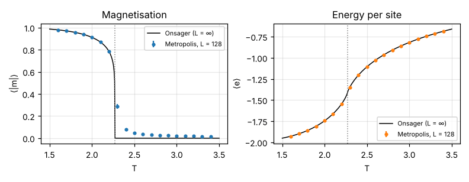
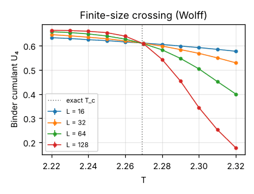
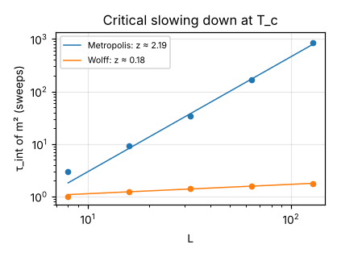
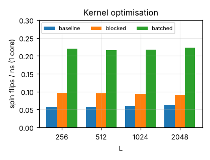

# ising-hpc: parallel Monte Carlo for the 2D Ising model

[](https://github.com/sohamgugale/ising-hpc/actions/workflows/ci.yml)

C++17 simulation of the 2D Ising model with checkerboard **Metropolis** updates in three backends (serial, OpenMP, MPI) and the **Wolff** cluster algorithm.

The code is verified at three levels:
- **Unit:** known-answer tests for the random-number generator.
- **Statistical:** comparison against exact enumeration of a 4×4 lattice.
- **Physical:** comparison against Onsager's exact solution.

Every backend produces a **bit-identical** lattice, regardless of thread or rank count.

| Result | Value |
|---|---|
| Agreement with Onsager's exact solution (L = 128) | energy within 0.05 % at every temperature outside the critical region; magnetization within 0.05 % below T_c |
| Critical temperature from Binder-cumulant crossing (L = 64/128) | **2.2698 ± 0.0005** (exact 2.2692) |
| Dynamic exponent, Metropolis | **z = 2.19 ± 0.06** (literature ≈ 2.17) |
| Wolff vs. Metropolis decorrelation at T_c, L = 128 | **1.8 vs. 844 sweeps (≈ 475× faster)** |
| Single-core kernel optimization | **3.6–3.8×** over the baseline kernel |
| Parallel efficiency on 2 cores (L = 2048) | 96 % (OpenMP), 99 % (MPI) |

---

## Why the Ising model

The Ising model is a lattice of spins sᵢ = ±1 with energy E = −Σ⟨ij⟩ sᵢsⱼ. In 2D it has a phase transition at T_c = 2/ln(1 + √2) ≈ 2.269. It is one of very few interacting models with an exact solution (Onsager, 1944), which makes it the standard test bed for Monte Carlo and parallel-simulation code: every number this program produces can be checked against theory.

## How it works

**Metropolis on a checkerboard.** The algorithm is a Markov chain whose stationary distribution is the Boltzmann distribution:
- A spin flip is accepted with probability min(1, e^(−βΔE)).
- Colouring the lattice like a checkerboard means every neighbour of a black site is white, so all sites of one colour can be updated at the same time without data races.
- Each sweep therefore runs two fully parallel half-sweeps.

**Counter-based random numbers.** Random numbers come from Philox4x32-10 (Salmon et al., SC'11):
- Philox is a stateless function of (counter, key).
- The counter is built from the site's *global* index, the sweep number and the sublattice.
- So the random number a site sees does not depend on which thread or MPI rank updates it. That is what makes all backends give bit-identical results, and that is checked on every build.

**MPI decomposition.** Rows are split into strips, one strip per rank (uneven splits are allowed). Each rank keeps one ghost row above and one below. Ghost rows are exchanged with `MPI_Sendrecv` after every half-sweep, with periodic wrap-around between the first and last rank.

**Wolff cluster algorithm.** It grows a cluster of aligned spins, adding each neighbour with probability 1 − e^(−2β), then flips the whole cluster at once. Near T_c this removes the critical slowing down that local updates suffer from (see results).

## Verification

`ctest` runs three suites:

| Test | What it checks |
|---|---|
| `philox_known_answers` | Philox output matches the Random123 known-answer vectors |
| `exact_enumeration_4x4` | Metropolis (both random streams) and Wolff averages of ⟨e⟩, ⟨\|m\|⟩, ⟨m²⟩ on a 4×4 lattice agree with exact enumeration of all 2¹⁶ states, at T = 1.8, T_c and 3.0, to within 5σ (observed: all within 2.5σ) |
| `backend_consistency` | final-lattice hash is identical for OpenMP 1/2/4 threads and MPI 1/2/3 ranks (including an uneven 50-row split), for every kernel |

### Against Onsager's exact solution

The figure below shows a 128×128 lattice with 50,000 measurement sweeps per temperature. Error bars account for autocorrelation through τ_int.



- **Below T_c:** ⟨|m|⟩ matches Onsager's spontaneous magnetization to within 0.05 % (≤ 1.7σ).
- **Energy:** matches the exact energy to within 0.05 % at every temperature except T = 2.3, inside the critical region.
- **Deviations near and above T_c are real finite-size effects, not errors.** A finite lattice has nonzero ⟨|m|⟩ above T_c, decaying as L^(−γ/2ν).
- **Starting state:** runs below T_c start from an ordered lattice. A random start on a periodic lattice can freeze into long-lived stripe domains, which a first version of this experiment ran into at T = 1.7 and 1.9.

### Locating T_c from finite-size scaling

The Binder cumulant U₄ = 1 − ⟨m⁴⟩/3⟨m²⟩² is almost independent of L at T_c, so curves for different lattice sizes cross there. The data come from Wolff runs, and errors come from a blocked jackknife plus resampling of the crossing.



| Sizes | Crossing T |
|---|---|
| 16 / 32 | 2.2677 ± 0.0009 |
| 32 / 64 | 2.2682 ± 0.0006 |
| 64 / 128 | 2.2698 ± 0.0005 |
| exact | 2.2692 |

The crossings drift toward the exact value as L grows, as finite-size corrections predict. The crossing value U₄ ≈ 0.61 matches the known universal value (≈ 0.611).

## Critical slowing down: Metropolis vs. Wolff

At T_c, the integrated autocorrelation time τ_int of m² (Sokal's automatic window) grows as L^z. Wolff time is converted to sweeps by multiplying by the mean cluster fraction.



| L | Metropolis τ (sweeps) | Wolff τ (sweeps) |
|---|---|---|
| 8 | 2.95 ± 0.06 | 1.00 ± 0.01 |
| 16 | 9.1 ± 0.3 | 1.22 ± 0.02 |
| 32 | 33.7 ± 2.1 | 1.40 ± 0.03 |
| 64 | 166 ± 21 | 1.58 ± 0.04 |
| 128 | 844 ± 110 | 1.78 ± 0.05 |

- **Metropolis:** fitting L ≥ 16 gives **z = 2.19 ± 0.06**, consistent with the accepted 2.17 (Nightingale & Blöte, 1996).
- **Wolff:** z = 0.18 ± 0.01 over this range. Published values are about 0.25 and are measured on larger lattices, so small-L corrections to scaling probably explain the gap.
- **Practical consequence:** at L = 128, getting one independent sample costs about 475× more sweeps with Metropolis than with Wolff.

## Performance engineering

Single-core throughput is measured in spin updates per nanosecond, best of 3 runs (`results/bench_kernels.csv`). Each step below was kept only if the backend-consistency test still passed.

1. **`baseline`** (≈ 0.06 flips/ns): one Philox call per spin update, with the acceptance check written as an `if`.
2. **`blocked`** (≈ 0.095 flips/ns, **1.6×**): one Philox call produces four 32-bit outputs, which now serve four neighbouring same-colour sites. Acceptance compares integers against precomputed 2³²·e^(−βΔE) thresholds.
3. **`batched`** (≈ 0.22 flips/ns, **3.6–3.8×**):
   - Phase one generates the random numbers for a whole row in a structure-of-arrays loop that the compiler vectorizes (`-fopt-info-vec` confirms it). That cut the random-number cost to 1.6 ns per update, out of about 8.6 ns total.
   - The remaining cost was the accept/reject branch, which near T_c is close to a coin flip and so is constantly mispredicted. Making the update branchless (a table lookup plus multiplying the spin by ±1) roughly doubled throughput again.
   - `batched` draws exactly the same random numbers as `blocked`, and the tests check that they match.



| L | baseline | blocked | batched | speedup |
|---|---|---|---|---|
| 256 | 0.057 | 0.096 | 0.220 | 3.8× |
| 512 | 0.057 | 0.095 | 0.217 | 3.8× |
| 1024 | 0.060 | 0.094 | 0.217 | 3.6× |
| 2048 | 0.063 | 0.091 | 0.223 | 3.6× |

### Parallel scaling

The development machine has only **2 cores**, so these numbers show correctness and low overhead, not large-scale scaling. Results are for L = 2048 with the `batched` kernel:

| Backend | 1 worker | 2 workers | Speedup | Efficiency |
|---|---|---|---|---|
| OpenMP | 0.219 | 0.422 | 1.92× | 96 % |
| MPI | 0.209 | 0.413 | 1.98× | 99 % |

Halo exchange moves two rows of L bytes per rank per half-sweep, against L²/P site updates. Communication is negligible until the strips get only a few rows tall. Run `python3 scripts/experiments.py --only scaling` on a multi-core node or cluster to extend this table.

## Build and run

You need a C++17 compiler with OpenMP, CMake ≥ 3.16, and (optionally) an MPI library.

```bash
cmake -S . -B build -DCMAKE_BUILD_TYPE=Release
cmake --build build -j
ctest --test-dir build --output-on-failure
```

Metropolis, OpenMP:

```bash
OMP_NUM_THREADS=4 ./build/ising --L 512 --T 2.269 --sweeps 10000 --therm 1000 --out run.csv
```

Metropolis, MPI (4 ranks):

```bash
mpirun -np 4 ./build/ising_mpi --L 2048 --sweeps 500 --every 0
```

Wolff cluster algorithm:

```bash
./build/wolff --L 128 --T 2.269 --clusters 100000 --out wolff.csv
```

Options for `ising` and `ising_mpi`:

| Option | Meaning |
|---|---|
| `--L` | lattice size (even) |
| `--T` | temperature |
| `--sweeps`, `--therm` | measured and thermalisation sweeps |
| `--every` | measurement interval (0 = none) |
| `--seed` | random seed |
| `--start hot\|cold` | random or all-up initial lattice |
| `--kernel batched\|blocked\|baseline` | update kernel |
| `--out` | CSV time series of e and m |

Each run prints a summary line with throughput and a checksum of the final lattice.

To reproduce every table and figure (needs Python with NumPy, SciPy and Matplotlib):

```bash
python3 scripts/experiments.py   # writes results/*.csv; raw time series go to raw/
python3 scripts/plots.py         # writes results/*.png
```

## Layout

| Path | Contents |
|---|---|
| `include/philox.hpp` | Philox4x32-10 counter-based RNG |
| `include/lattice.hpp` | lattice storage, the three Metropolis kernels, observables |
| `include/wolff.hpp` | Wolff cluster algorithm |
| `src/ising.cpp` | Metropolis driver (OpenMP build and MPI build) |
| `src/wolff.cpp` | Wolff driver |
| `tests/` | known-answer, exact-enumeration and backend-consistency tests |
| `scripts/experiments.py` | runs all experiments, computes τ_int, jackknife errors, Onsager references |
| `scripts/plots.py` | figures |
| `results/` | summary tables and figures |

## Next steps

- **GPU kernel (CUDA):** the counter-based RNG and checkerboard structure carry over directly. Results would be checked against the CPU checksum.
- **Memory layout:** store each sublattice contiguously (instead of stride-2 access in one array) so the update loop itself vectorizes.
- **Multi-spin coding:** pack 64 spins per word.
- **MPI:** 2D (block) decomposition, and overlapping halo exchange with interior updates.

## References

- L. Onsager, *Phys. Rev.* 65, 117 (1944); C. N. Yang, *Phys. Rev.* 85, 808 (1952)
- U. Wolff, *Phys. Rev. Lett.* 62, 361 (1989)
- J. K. Salmon et al., "Parallel random numbers: as easy as 1, 2, 3", SC'11 (2011)
- A. D. Sokal, "Monte Carlo methods in statistical mechanics", Cargèse lectures (1996)
- M. P. Nightingale and H. W. J. Blöte, *Phys. Rev. Lett.* 76, 4548 (1996)
- K. Binder, *Z. Phys. B* 43, 119 (1981)
